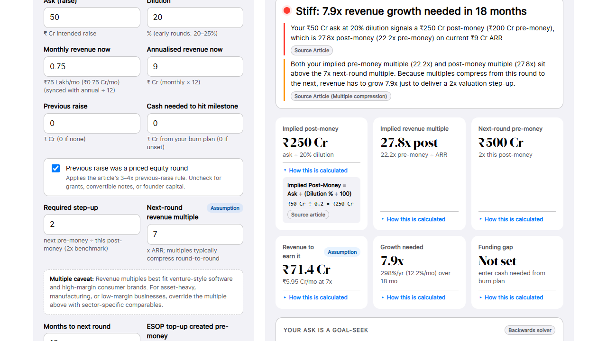

# Ask Reality Check

**Test a startup fundraise ask before you pitch—working backwards from what the next round must pay.**



## What It Is

Even when a founder never mentions a valuation in a pitch, quoting a fundraise **Ask** immediately signals an implied post-money valuation ($\text{Ask} \div \text{Dilution}$). Institutional VCs evaluate that valuation by working backwards from whether the *next* round can pay at least **2x** for it in **15–18 months**.

**Ask Reality Check** is a 100% client-side, open-source web calculator based on Sajith Pai’s note, [*"The rookie fundraising mistake that even some experienced founders make!"*](https://www.linkedin.com/pulse/rookie-fundraising-mistake-even-some-experienced-founders-sajith-pai-nvl2c/).

- **100% Client-Side & Private:** No backend, no user accounts, no analytics, and zero network calls with your inputs. Everything runs locally in your browser and works offline after the first load.
- **Every Number Traceable:** Expand *"How this is calculated"* under any tile, chain item, goal-seek output, or sensitivity table to inspect the exact formula, substituted values, and whether a benchmark comes from the **Source Article** or **Our Assumption**.
- **Integrated Goal-Seek Solver:** Solve backwards for the **largest defensible ask**, **current revenue needed**, or **target dilution** required to clear a chosen growth ceiling.
- **Multi-Unit & Shareable:** Switch between `₹ Cr`, `₹ Lakh`, and `USD ($M)`. Every scenario is encoded in the URL query string for one-click sharing, Markdown copy, or PDF printing.

---

## How the Maths Works in Five Lines

1. **Implied Post-Money Today:** $\text{Post-Money} = \text{Ask} \div (\text{Dilution\%} / 100)$ *(at 20–25% dilution, your ask signals a valuation of 4–5x the raise)*.
2. **Effective Pre-Money:** $\text{Pre-Money} = \text{Post-Money} - \text{Ask}$, reduced further by any pre-money ESOP pool top-up ($\text{Post-Money} \times \text{ESOP\%}$).
3. **Next-Round Target Valuation:** $\text{Next Pre-Money} = \text{Post-Money} \times \text{Step-Up}$ *(minimum $2\times$ in 15–18 months)*.
4. **Revenue Needed to Earn It:** $\text{Required Next ARR} = \text{Next Pre-Money} \div \text{Next-Round Revenue Multiple}$ *(accounting for multiple compression)*.
5. **Required Growth & Goal-Seek:** $\text{Growth Multiple} = \text{Required Next ARR} \div \text{Current ARR}$ — or invert the equation to solve for the maximum ask that clears a reachable ($\le 3\times$) or stretch ($\le 5\times$) growth ceiling.

For full derivations and the complete origin table of article benchmarks vs. tool assumptions, see [docs/ask-check-method.md](./docs/ask-check-method.md).

---

## How to Run Locally

Requires [Node.js](https://nodejs.org/) (v18+ recommended).

```bash
# Install dependencies
npm install

# Start local development server
npm run dev

# Run pure calculation engine unit & acceptance tests (Vitest)
npm test

# Build production bundle
npm run build

# Run end-to-end browser verification (Playwright)
npm run test:e2e
```

---

## Credit & Disclaimer

- **Conceptual Framework:** Based on [Sajith Pai’s LinkedIn note](https://www.linkedin.com/pulse/rookie-fundraising-mistake-even-some-experienced-founders-sajith-pai-nvl2c/) (October 2026) and the accompanying comment discussion (including Adityavikram Banka’s note on pre-money ESOP pool dilution).
- **Design System:** **TheKanishkaMohan** · Pareto’s Edge / Incrementally Original.
- **Disclaimer:** This is an unofficial, independent thinking aid. It is **not** affiliated with or endorsed by Sajith Pai or Blume Ventures, and nothing in this tool constitutes financial, legal, or investment advice.

## License

Released under the [MIT License](./LICENSE).
